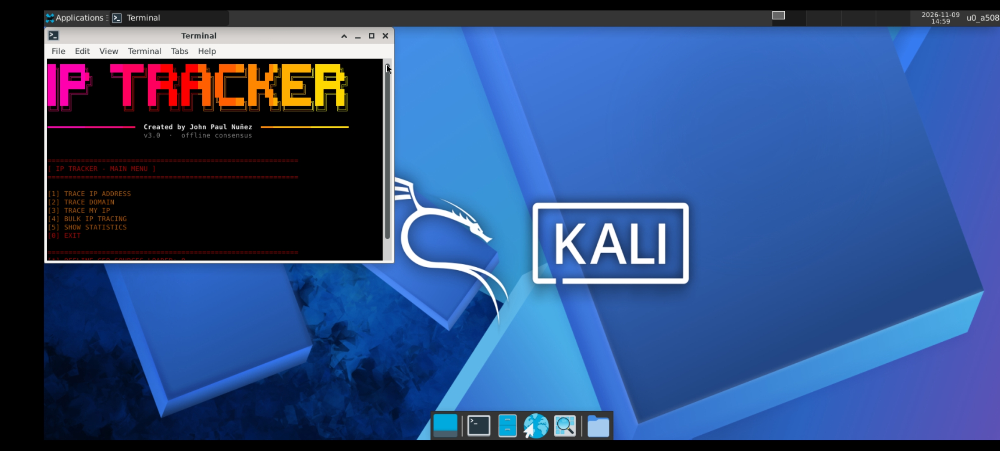
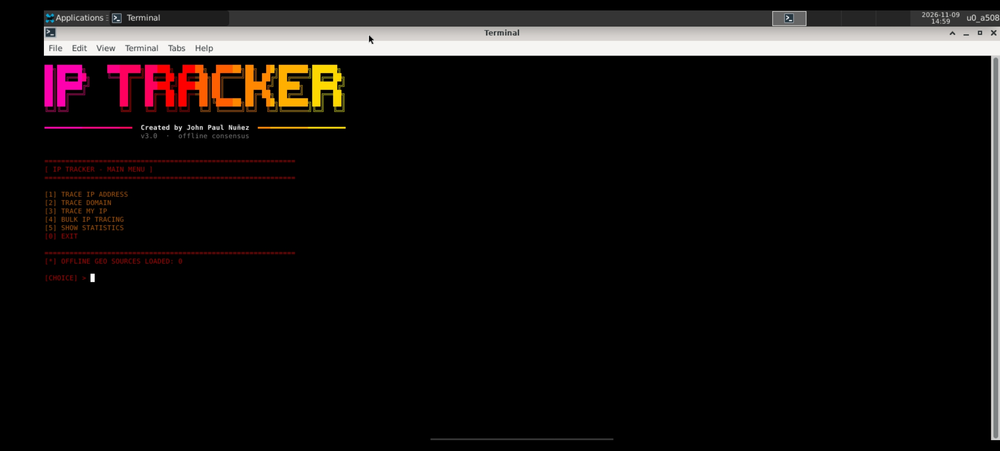

# IP Tracker

A colorful terminal IP lookup tool that uses **no web APIs**. Geolocation comes from offline database libraries, and everything else uses Python's standard `socket` module.

Works on **Windows, Linux, Kali, and Termux (Android)**.

## Screenshots





## Features

- Offline multi-source geolocation with consensus voting, confidence score, and precision level
- Country details (currency, languages, calling code) from offline `babel` and `phonenumbers` data
- Reverse DNS
- WHOIS and abuse contact (direct WHOIS protocol, port 43)
- Public IP detection through STUN (UDP, no HTTP API)
- IPv4 and IPv6, domain tracing, and bulk tracing
- Optional threaded port scan and web server detection
- Map link and JSON export

## Installation

### Linux / Kali / Windows
```bash
git clone https://github.com/johnpaulnunez333-cloud/IP-TRACKER
cd IP-TRACKER
pip install -r requirements.txt
python IP_TRACKER.py
```

### Termux (Android)
```bash
pkg install python git
git clone https://github.com/johnpaulnunez333-cloud/IP-TRACKER
cd IP-TRACKER
pip install -r requirements.txt
python IP_TRACKER.py
```

## Usage

Main menu:

| Option | Action |
|---|---|
| 1 | Trace an IP address |
| 2 | Trace a domain |
| 3 | Trace my IP |
| 4 | Bulk IP tracing |
| 5 | Show statistics |
| 0 | Exit |

After each trace, the result screen shows the location, network, and country details. From there you can:

| Option | Action |
|---|---|
| 01 | Return to the main menu |
| 02 | Exit |
| 03 | More details (accuracy, WHOIS, source breakdown) |
| 04 | Scan ports |
| 05 | Save results as JSON |

## How it works

1. The IP is validated, and private or reserved addresses are rejected.
2. Offline geolocation databases, WHOIS, and reverse DNS are queried at the same time.
3. The databases vote on the country, then the region, then the city. The coordinates are the median of the agreeing sources.
4. A confidence score is calculated from how many sources agree and how close their coordinates are.

## Geolocation sources

| Source | Provides | Notes |
|---|---|---|
| `geoip2fast` | Country, ASN organization | Bundled database |
| `maxminddb-geolite2` | City, region, coordinates | Bundled, older data, used only if no `.mmdb` file is found |
| Your own `.mmdb` files | City, region, coordinates, ASN | Best accuracy |

For the best city-level results, download a free GeoLite2 or DB-IP Lite `.mmdb` file and place it next to `IP_TRACKER.py`, in a `data` folder, or in a folder set by the `IPTRACKER_DB_DIR` environment variable.

## Limitations

- IP geolocation is approximate and usually points to the ISP's network hub, not the exact user.
- Bundled databases can be outdated. Update the packages or use fresh `.mmdb` files.
- Offline databases often share the same upstream data, so agreement between them does not guarantee accuracy.
- WHOIS (port 43) and STUN (UDP) can be blocked by some networks.
- Without a city-level database, only the country and network are shown.

## Disclaimer

Use this tool only for lawful purposes. Use the port scan only on hosts you own or have permission to test.

## Author

Created by John Paul Nuñez
